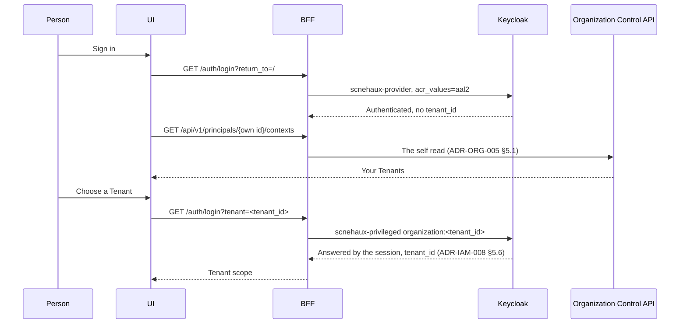
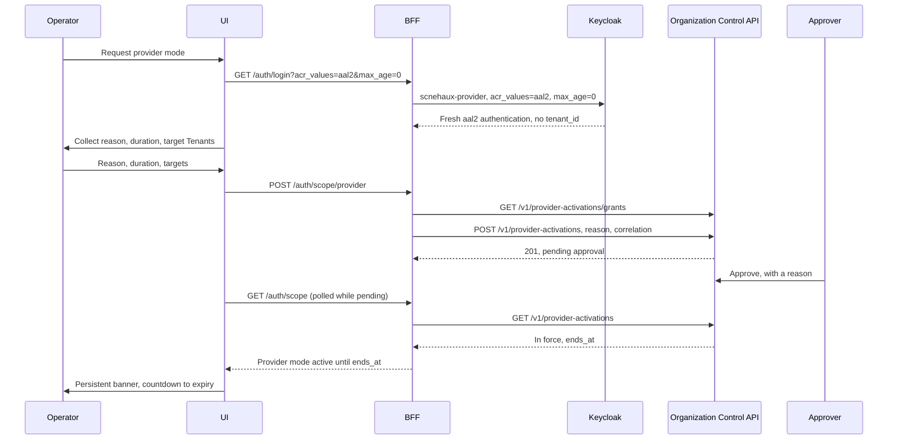

---
doc_meta:
  id: TDD-organization-experience-001
  title: Administrative Scope, Provider Mode, and Safe Bulk Operations
  owner: Core Platform Team
  version: 1.19.0
  status: approved
  classification: restricted
  review_cycle_days: 90
  created_date: 2026-08-11
  last_reviewed: 2026-10-31
  parent_sad: SAD-012
---

# Administrative Scope, Provider Mode, and Safe Bulk Operations

## Purpose

Specify how the Organization administrative experience makes the operator's scope
unmistakable, how provider-scoped cross-tenant work is entered deliberately rather
than drifted into, and how bulk and irreversible operations are presented so that the
outcome is understood before it is committed.

SAD-012 §1 states the requirement plainly: the experience must make administrative
scope explicit and prevent accidental cross-tenant action. That is a user-interface
obligation with a security consequence, which is why it is designed rather than left
to visual convention.

## Scope

**In scope**

- The two administrative scopes and how an operator moves between them.
- Provider mode: entry, assurance, visual state, reason capture, and exit.
- Bulk operations: preview, per-item outcome, and partial-failure presentation.
- Presentation of projection freshness and of revocation that is queued but not yet
  enforced.
- Irreversible operations and their confirmation contract.

**Out of scope**

- The backend-for-frontend session pattern, cookie properties, cross-site request
  forgery defence, refresh, step-up mechanics, and back-channel logout. This
  application conforms to `TDD-identity-experience-001` without variation.
- Membership authority, versions, and revocation mechanics — owned by
  `TDD-organization-control-002`.
- Row-Level Security and the two database runtime roles — owned by
  `TDD-organization-control-001`.
- Visual design language and component composition, owned by the UI Platform (`@scnx/system` and
  `@scnx/core-ui`, 1.18.0)
  its primitives; until then by this repository's own components (SAD-012 1.1.0 §7.3).

## Technical Context

This application conforms in full to the BFF pattern specified in
`TDD-identity-experience-001`: an opaque `__Host-` session cookie, all tokens held
server-side, three independent cross-site request forgery defences, server-side
refresh, and idle plus absolute expiry. Nothing about that pattern is restated or
varied here, and a divergence in this repository is a defect rather than a local
decision.

**A session-store outage (1.5.0).** The pattern's own behaviour, at the pin
`bff/conformance.json` names (`TDD-identity-experience-001` 1.17.0 §Session-Store Outage): a store
that does not answer is answered `503 dependency-unavailable` with the session and its cookie kept, a
sign-in lands on `?sign-in=unavailable`, and a session that no longer opens under
`ORGANIZATION_EXPERIENCE_SESSION_KEY` is a signed-out one, never a `500`. The provider window store
lives in the same database, so its queries name an outage the same way, and a scope route answers
`503` too. `bff/test/store-outage.test.ts` is the source's, byte for byte.

What differs is the thing this application administers. The Organization control plane
distinguishes two callers at the database level, with two PostgreSQL runtime roles and
two connection pools:

| Scope | Database role | Reaches |
| :-- | :-- | :-- |
| Tenant administration | `organization_rt` | Exactly one Tenant |
| Provider administration | `organization_provider_rt` | Deliberately across Tenants |

That separation is enforced by PostgreSQL and by the API. This design carries it into
the interface, because a boundary the operator cannot see is a boundary the operator
will cross by accident.

**The session record ends with its session (1.13.0, `STD-IAM-001` 3.0.0 §3.4).** The standard asks that
a record be deleted at the earliest of the absolute timeout, the idle timeout, logout and revocation,
"by an expiry on the record", and that the store be excluded from backup and restore and not be an
authoritative store. This application's BFF store is identity-experience's, byte for byte
(`bff/conformance.json`: `bff/migrations/0001_sessions.sql`, `bff/src/session/store.ts`,
`bff/src/session/sessions.ts`), so it conforms as `TDD-identity-experience-001` 1.23.0 §Data Model
records. The evidence here: the `idle_expires_at` and `absolute_expires_at` columns;
`SessionStore.purgeExpired`, run every five minutes by `bff/src/server.ts` (this repository's own file,
which keeps the same interval); `destroy` on sign-out and `destroyForLogout` on a back-channel logout.
The test is `bff/test/auth.test.ts`, "session lifetime": the purge deletes an expired session that was
never presented and keeps a live one. No backup script and no restore drill exists here, so none
includes the session store (`deploy/dev/README.md` §Backups). No `bff/` conformance-set file changed.

## Component Design

| Component | Responsibility |
| :-- | :-- |
| `ScopeContext` | Holds the active scope, exposes it to every view, refuses ambiguous state |
| `ProviderModeGate` | Entry ceremony: step-up, reason, scope selection, expiry |
| `ScopeBanner` | Persistent, non-dismissible indication of the active scope |
| `BulkOperationRunner` | Preview, submit, per-item outcome, resumable reporting |
| `FreshnessIndicator` | Surfaces projection age and stale behavior to the operator |
| `ConfirmationGate` | Confirmation contract for irreversible operations |
| `AppFrame` | The navigation rail, the bar with the session, and the banner under it (1.9.0, §Visual Language) |

### The Two Scopes

```text
Tenant scope                          Provider scope
├── one Tenant, resolved from the     ├── explicitly selected Tenants or all
│   operator's administrative         ├── requires step-up authentication
│   assignment                        ├── requires a reason before entry
├── default on sign-in                ├── time-bounded, expires automatically
└── no reason required                └── every action emits a privileged event
```

An operator never holds both simultaneously. Provider mode is entered, used, and left,
and the session records which scope was active for every action taken.

### The Scopes as Tokens and Records (1.2.0)

The two scopes are two token forms, and the session holds one (`ADR-IAM-008`). This BFF's client
is registered for the `per-sign-in` privileged form, so every sign-in names one:

| Scope    | Sign-in                                                                    | Authority, read by the Organization Control API on every request |
| :------- | :------------------------------------------------------------------------- | :--------------------------------------------------------------- |
| Tenant   | `/auth/login?tenant=<tenant_id>`: `scnehaux-privileged organization:<tenant_id>` | Tenant administration grant, active Membership, active Tenant (`ADR-ORG-003`) |
| Provider | `/auth/login?acr_values=aal2&max_age=0`: `scnehaux-provider`                 | An activation in force, approved by another provider (`ADR-ORG-002 §5.1`) |

- **The scope comes from the session, never from browser input.** The BFF pattern holds the ID
  token's `tenant_id` to the Tenant asked for, and stores the confirmed one
  (`TDD-identity-experience-001` 1.15.0 §Context Switch). A session with a Tenant is in Tenant scope.
  A session without one is in provider scope.
- **Moving between scopes is a sign-in**, which replaces the session. Entering provider scope always
  re-authenticates at `aal2` (`max_age=0`), as Entra PIM can require "reauthentication on every role
  activation" [R1].
- **"Default on sign-in" is the Tenant scope** when the operator names a Tenant. Until 1.11.0 the
  Tenant was typed on the entry page, or arrived on a deep link, because the kernel's own chooser is
  not yet asserted (`ADR-IAM-008` Alternative D). From 1.11.0 the person signs in without a Tenant and
  chooses one of their own (§The Sign-In Entry).
- **A provider session is not yet provider mode.** Its holder is eligible: the Organization Control
  API admits it to `/v1/provider-activations` alone. Provider mode is a window: an activation the
  operator requests with a reason and a duration, and another provider approves (§Provider Mode
  Entry).

### The Sign-In Entry (1.11.0)

Reported from the development server: to sign in for a Tenant a person had to know its identifier, a
UUID, and the provider sign-in sat beside that field. 1.11.0 signs the person in first and lets them
choose.



**One neutral sign-in.** The signed-out entry's primary action is **Sign in**, `/auth/login` with no
Tenant, returning to the page the person was on.
- **It is the request the BFF already sends.** A token must carry one form, and a request that names
  neither "gets a token without `principal_id`, and every resource refuses it" (`ADR-IAM-008 §5.1`).
  So the sign-in that names no Tenant asks for the provider-scope form, at the application's `aal2`
  and without `max_age=0`.
- **That form confers nothing.** It "grants nothing" (`ADR-IAM-008 §5.5`). Without an activation the
  Organization Control API admits the person to two self routes alone: their own contexts
  (`ADR-ORG-005 §5.1`) and an invitation's acceptance (`ADR-ORG-007 §5.1`).
- **It is the acceptance page's sign-in.** `ADR-ORG-007 §5.6`: "The BFF signs the person in without a
  Tenant, as it does to list their contexts". An invited person and an administrator now enter the
  same way.
- **The BFF does not change.** `/auth/login`, its callback check (`ADR-IAM-008 §5.3`) and the scope
  guard's two self routes (§The Scope Guard) are as they were. No file of `bff/conformance.json`'s
  identical set is touched.

**Then "Your Tenants".** The overview of a session without a Tenant lists the person's own contexts
first (`TDD-organization-experience-002` 1.9.0 §The Picker After Sign-In).
- **Choosing an entry is the Tenant sign-in**, `/auth/login?tenant=<tenant_id>` (`ADR-ORG-005 §5.3`,
  `ADR-IAM-008 §5.2`). On the kernel session the neutral sign-in made, the kernel's Organization
  Identity-First step answers it with no page and no credential (`ADR-IAM-008 §5.6`). The BFF session
  is replaced; the kernel session it names is the same one.
- **Several Tenants: a list to pick from after the sign-in**, as the platforms do:
  - Auth0: "Users in multiple Organizations are directed to the Organization Picker after the login
    flow, which displays the first 20 organizations they joined" [R8];
  - Slack: "If you are a member of multiple workspaces, you can choose which one you want to open after
    you sign in." [R9];
  - the Azure portal: "To switch to a different directory, find the directory that you want to work in,
    and then select the **Switch** button in its row." [R10];
  - GitHub's "Switch dashboard context" menu "lists organizations linked to the personal account" [R11].
- **One Tenant: listed, not entered by itself.** WCAG's Change on Request: "Changes of context are
  initiated only by user request or a mechanism is available to turn off such changes" [R12]. Two
  more reasons:
  - the person may have signed in for something else: an invitation, or provider work;
  - a Tenant sign-in the kernel refused lands back on the overview, which would start it again.
- **No Tenant:** the list says so, and what to do: a Tenant administrator invites the person, who
  opens the link they are sent (`ADR-ORG-007`).
- **The list cannot be read:** it says why, as every list here does: the API's refusal with its
  reference, or that Organization Control could not be reached.

**Sign in as a provider** is the secondary action, set apart under a rule.
- It is the provider form's step-up, `acr_values=aal2&max_age=0` (`ADR-IAM-008 §5.4`), unchanged.
- It returns to **`/provider-mode`**, the page that holds the entry ceremony (§Provider Mode Entry).
  The overview of a session without a Tenant offers that page under **Provider administration**, below
  the person's Tenants.
- A provider window open in the session puts the window first on the overview, as before.

**No Tenant identifier field.** It goes from the entry page and from the overview's switch, decided
from the ADRs:
- **The list holds every Tenant a Tenant sign-in can serve.** It has "One entry per active Membership
  in an active Tenant" (`ADR-ORG-005 §5.2`). Tenant administration needs an active Membership and an
  active Tenant (`ADR-ORG-003`), and the kernel issues `organization:<tenant_id>` "only for a member"
  (`ADR-ORG-005 §5.3`).
- **A person with no listed context gains nothing by typing one.** The kernel rejects a non-member's
  request (`ADR-IAM-008 §5.6`), and the API refuses a Membership that is not active.
- **A list that cannot be read is Organization Control not answering.** Every Tenant-scope read goes
  to the same API, so a Tenant entered by its identifier would not answer either.
- **`ADR-ORG-005 §6` expects it:** "A Tenant administrator chooses a Tenant from a list instead of
  typing an identifier."
- **A deep link still works.** The sign-in returns to the page it started on. A Tenant surface reached
  without a Tenant lists the person's Tenants under its notice, and each entry's sign-in returns to
  that surface. `/auth/login?tenant=` itself is unchanged, for a link that names its Tenant.
- **Provider mode still takes identifiers.** Its targets are Tenants the provider is usually not a
  member of, so they are not in the provider's contexts.

**The banner for a session without a Tenant** reads "Signed in without a Tenant: provider mode is not
active". Until 1.11.0 it read "Provider sign-in: provider mode is not active".
- The neutral sign-in and the provider sign-in make the same form, and the BFF cannot tell them apart.
  The page does not try to, because the form grants nothing.
- Entering provider mode is checked where it always was: `POST /auth/scope/provider` requires `aal2`
  and an `auth_time` within `ORGANIZATION_EXPERIENCE_PROVIDER_STEP_UP_AGE`, then a provider grant, then
  another provider's approval.

### Provider Mode Entry

1.2.0 realizes the entry through the provider form's sign-in and an activation, which the
Organization Control API records and enforces (`ADR-ORG-002`, `TDD-organization-control-001`
§Provider Activation).



**The order is the control.**

1. **The step-up comes first.** `POST /auth/scope/provider` refuses a session that is not in the
   provider form, below `aal2`, or whose `auth_time` is older than
   `ORGANIZATION_EXPERIENCE_PROVIDER_STEP_UP_AGE`.
2. **The reason comes before the window opens.** It is the activation's own reason, recorded by the
   Organization Control API at the request, as Entra PIM asks for "a business justification when
   they activate" [R1].
   - A request without one is refused by the BFF, and again by the API.
   - A reason captured after the fact is written by someone who already knows the outcome, which is
     worth less than one written before it.
3. **The duration is bounded twice.** The BFF refuses one above
   `ORGANIZATION_EXPERIENCE_PROVIDER_MAX_DURATION`, and the API refuses one above its own maximum.
4. **Another provider approves**, in production (`ADR-ORG-002 §5.1`). Until then the window is
   pending, and the banner says so.
   - The same application shows a provider the activations awaiting its decision.
   - Approving or denying needs a reason of its own.
   - An operator's own request is never offered to them for approval, and the API refuses it.

**The window ends on its own.** The activation's `ends_at` is the scope's expiry: the duration
counted from the approval. An operator who forgets to leave provider mode leaves it anyway, and the
API stops honouring the activation at that instant whatever the BFF does. Leaving early ends the
activation (`POST /v1/provider-activations/{id}/end`). Signing out ends it too, so authority never
outlives the session that asked for it.

**The targets narrow; they do not grant.** The activation covers the whole provider scope.
- **The window records what the operator named:** explicit Tenants, or all of them. The BFF refuses
  a request naming any other Tenant, in its path or in its body's `tenant_id`.
- **This prevents mistakes, not attacks** (§Security Notes). It is what keeps an operator who meant
  one Tenant from acting on another.

### Scope Visibility

The active scope is shown by a persistent element that cannot be dismissed, collapsed,
or scrolled away, and that names the scope, the target, and the remaining time. Every
destructive control carries the scope in its confirmation text rather than relying on
the operator remembering the banner.

This is deliberate redundancy. The single most likely error in cross-tenant
administration is an operator acting correctly on the wrong Tenant, and that error is
invisible at the moment it is made.

**On a small viewport, one sticky line (1.12.0).** `SAD-012` 1.4.0 §8.4: "The scope is always in view
(1.4.0). Its kind, the Tenant when there is one, and the time left stay in view at every width,
compacted to one sticky line on a small viewport. The full scope banner, with any long text, is in the
page flow." `STD-GLB-FE-005` 2.3.0 §3.10 sets the rule for every sticky region: the sticky line is
compact "when the viewport is narrower than `60rem` or shorter than `30rem`, either one", and only what
a SAD requires in view stays sticky, on one line; everything else becomes static. "Above both
thresholds, the sticky region may hold the full banner, and the full banner may wrap to more than one
line there" (2.3.0, 1.13.0).

- **What sticks.** Below `60rem` wide, or below `30rem` tall, the bar and the full banner become static
  and scroll away with the page. A scope line takes their place at the top of the viewport. It is the
  frame's first row, above the rail, so it is in view from the top of the page as well as after any
  scroll, and the rail's contents stop sticking there so nothing slides under it. It holds the
  scope's glyph and kind, the Tenant for a Tenant scope or the number of Tenants a window reaches, and
  the time left. It is one line, in the banner's scheme. The kind and the Tenant end in an ellipsis
  when they do not fit; the time left never shrinks. Nothing wraps in it.
- **Why those thresholds.** `60rem` is the breakpoint at which the rail already becomes a bar
  (§Visual Language). `30rem` (480 CSS px) is under a laptop screen at 150% zoom and above WCAG's
  256 CSS px case, "a starting viewport height of 1024 CSS pixels at 400% zoom" [R13]: a sticky bar and
  banner of about 100 px there would take two fifths of the screen. Technique C34 un-fixes sticky
  regions by media query because "sticky regions may block a big portion of the screen" [R14].
- **The full banner stays in the page,** above the content, so every word of it, a long Tenant list
  included, is still read in the flow. The scope line is a visual summary of it and is hidden from
  assistive technology, so a screen reader reads the scope once, from the banner's region.
- **Focus is never hidden under the sticky region.** The frame sets the root's `scroll-padding-top`
  to the height of whatever is sticky, the bar and banner above `60rem`, the scope line below, measured
  as it changes. Technique C43 uses scroll padding so that components "that are initially completely
  obscured by a fixed-position component can still be accessed by users" [R15], and SC 2.4.11 asks that
  a focused component "is not entirely hidden due to author-created content" [R13].
- `e2e/browser/layout.spec.ts` checks it at 320 by 256 CSS px and at 1440 by 900: the sticky region is
  one line on the small one, in view at the top of the page and at its end, and tabbing backwards from the end of the page never leaves the focused
  element entirely under it (§Testing Strategy). Since 1.13.0 the backward tab runs at 1440 by 900 too,
  under the bar and the full banner that stick there and may wrap, as `STD-GLB-FE-005` 2.3.0 §3.10
  asks: "The same tab check runs once above both thresholds".

### Visual Language (1.9.0, the UI Platform since 1.18.0)

**The administration console looks like Identity Experience's applications.** An operator signs in on
identity-kernel's hosted login and moves between this console and Identity Experience's Admin Portal.
The three read as one product. Until 1.9.0 this application had one stylesheet of four rules, the scope
banner's, and the browser's own form controls everywhere else.

**The UI Platform (1.18.0).** The console draws with the UI Platform's packages, `@scnx/system` and
`@scnx/core-ui` 2.0.0-beta.0, in the `scnx-platform` theme: the Scnehaux platform's own look, which
identity-experience took on in its pull request #66 (`TDD-identity-experience-003` 1.36.0 §Visual
Language). Its brand book is scnehaux-design `scnx-platform/Brand-Book.html` (`ADR-UIP-VIS-002`). Token
values and components belong to the packages; this repository writes no token. It meets the exit of
`ADR-ORG-008` (§5.1, §5.4): `apps/admin/src/ui/index.ts` re-exports `@scnx/system` and
`@scnx/core-ui`, and the copies are deleted. ROADMAP.md records the proposed status. Until
1.18.0 this application kept a copy of identity-experience's stand-in, taken at `c723e417` (its pull
request #54), tokens included.

- **Intake.** The packages are not on npm yet. `vendor/ui-platform/` holds the tarballs of one
  ui-platform CI run on `main`, at `2113337`, pinned by sha256 in `vendor/ui-platform/pin.json`: the
  same files and the same pin as identity-experience. `apps/admin/package.json` installs exactly them.
  `scripts/ui-platform.mjs`, identity-experience's port of ui-platform-docs' (`TDD-ui-platform-docs-001`
  D2), checks the pin (`pnpm vendor:check`, and its tests in `pnpm test:scripts`). CI's `ui-platform`
  job verifies each tarball's SLSA provenance with `gh attestation verify`: signed by ui-platform's CI
  workflow, from `refs/heads/main` at the pinned commit. A new pin is one reviewed change in each
  repository, with the same files.
- **One door.** `src/ui/index.ts` re-exports the packages, and nothing outside `src/ui/` imports them:
  ESLint's `no-restricted-imports` refuses an `@scnx/*` import anywhere else in `apps/admin/src`, as
  identity-experience's dependency-cruiser rule `platform-through-ui-only` does. An upgrade or a
  replaced component changes that file only.
- **The theme.** The platform's theme stylesheet selects its tokens only under
  `[data-scnx-theme="scnx-platform"][data-scnx-resolved-mode="light|dark"]` (`STD-UIP-TKN-002` §3.4).
  The platform's `ThemeProvider` writes both on `<html>` (`src/ui/preferences/ThemeRoot.tsx`), in its
  `system` mode until the viewer chooses (the departure below). `index.html` carries both with the dark
  mode, so the first paint has tokens: the content security policy allows no inline script that could
  set them sooner. The first render then takes the stored choice or the system's mode, read before the
  store connects, so a viewer whose system is dark sees no frame of the store's light default. A browser that answers
  no `prefers-color-scheme` query opens light, which is how the platform resolves `system` without an
  answer; until 1.18.0 it opened dark. Every current browser answers the query.
- **Square, lines, no glass.** The theme sets every radius to 0, keeping `pill` where a round shape
  carries meaning. A panel is the platform's Surface in the `panel` material, a 1px line. The canvas's
  two auroras and grid, the translucent surfaces with backdrop blur, the glows on the mark and the
  current navigation item, and the record list's shadow are gone, with the tokens that drew them.
- **Two voices.** Inter, which the package ships, speaks the content. IBM Plex Mono 400, 500 and 600,
  served from this origin with its OFL licence (`src/ui/styles/fonts/`), is the HUD voice: identifiers
  and figures in a table today. `@fontsource-variable/inter` and `jetbrains-mono` are removed, so
  JetBrains Mono is no longer drawn.
- **Layers.** The order is the platform's: `reset, tokens, base, components, recipes, utilities,
  overrides` (`STD-GLB-FE-005` §3.4). A composition's rules sit in `overrides` and read the platform's
  tokens or its `--scnx-*` hooks; none selects a platform class.

**The component map** is identity-experience's (its `packages/ui/README.md`), component for component,
and the files are copied from it at `f5424f0e`, the merge of its pull request #66. Each copied file names
its source in its first lines.

| Export | Kind | Platform | Why it is not a bare re-export |
| :-- | :-- | :-- | :-- |
| `ButtonBase`, `Badge`, `Alert`, `useTheme` | re-exported | core-ui / system | |
| `Button` | composed | `button` | identity-experience's composition: the label wraps at 320 CSS px, and a pressed toggle shows an edge (the platform draws no pressed state) |
| `Panel` | composed | `surface` (`panel`, `raised`) | The compound parts: Root, Header, Title, Description, Body. `Panel.Title` takes a heading level here, because a page's panels sit under its `h2` |
| `StatusPill` | composed | `badge` | A glyph per tone, so colour is never the only signal. It wraps |
| `Table` | composed | `table` | A required caption, and a named, focusable region that scrolls. `Cell mono` |
| `Icon` | local | none | The platform has no icon set. The brand's grammar: a 24-unit grid, a 1.8 stroke. Ten of its icons are this application's |
| `fieldClasses` | local | none; drawn as `text-field` | The forms here own their ids, hints and errors, so they take the platform's text field as classes, token for token, rather than identity-experience's `TextField`, `SelectField` and `TextAreaField` (departure below). An invalid field takes `danger.border.strong.selected`, as identity-experience's `TextField` does |
| `Notice` | local | none; drawn as `alert` | The platform's Alert is always a live region, `status` or `alert`. Ten of this application's 54 notices are standing guidance with no role, so a Notice takes the role its caller gives it and draws the Alert's tokens |
| `ThemeRoot`, `ThemeToggle` | local | core-ui `ThemeProvider` | The theme root over this application's stored choice; the toggle names the mode it moves to |
| `AppFrame`, `Page`, `Rows` | local | none | This application's frame, page and record rows, in the platform's tokens, drawn since 1.19.0 as identity-experience's and the documentation site's are (**The drawing**, below) |

**Tokens.** Every `--ds-*` name the stylesheets read is the package's. identity-experience's
`packages/ui/README.md` ("Tokens") maps each stand-in name to the platform's, and the same map renamed
them here. Three names had no use there:

- `--ds-size-icon-lg` (1.5rem) is `$icon-large` in `src/ui/styles/_roles.scss`, a glyph that stands
  alone: an empty state's, a stage's marker, the mark in the gate. The platform publishes no icon size
  token; identity-experience's roles stop at 20px.
- `--ds-color-{success,warning,info}-solid-default-default`, each drawn as an edge (a bulk outcome, the
  scope banner), is that scheme's `border-strong-default`, as identity-experience maps `danger`'s.

**Contrast is computed, not assumed.** `src/ui/styles/contrast.test.ts` reads both modes of the
`scnx-platform` theme from the pinned package's stylesheet, composites every pair over the canvas, and
holds text to 4.5:1 and what identifies a component, a state or focus to 3:1 [R5]. Its pairs are
identity-experience's, unchanged (`TDD-identity-experience-003` 1.36.0 §Contrast and Focus), then this
application's own: 69 a mode, and every one passes. The lowest are a field's edge in a confirmation and
a pressed toggle's edge, 3.30:1 in light. This application's own pairs, light / dark:

| Pair | Light | Dark |
| :-- | --: | --: |
| Scope banner lead and glyph, Tenant / provider mode / provider sign-in | 12.25 / 10.86 / 10.28 | 13.70 / 11.99 / 13.16 |
| Scope banner text (lowest) | 14.32 | 13.49 |
| Session pill in the bar | 5.39 | 7.81 |
| A row's facts under the pointer; selected | 4.86; 4.86 | 6.94; 6.94 |
| A status pill in a selected row | 5.28 | 11.35 |
| The danger note in a confirmation; a field's edge there | 6.11; 3.30 | 7.97; 3.65 |
| The current stage's text; its edge; a passed stage's check | 15.56; 4.50; 11.72 | 15.43; 3.99; 14.67 |
| An invalid field's edge (`danger.border.strong.selected`) | 4.55 | 3.85 |
| The platform's own invalid edge (`danger.border.strong.default`), not drawn here | 2.38 | 3.26 |
**The scope banner (§Scope Visibility).** It is drawn in the scheme of the scope it names, with its
own glyph and its words as well as its colour [R5, SC 1.4.1]: info and a building for a Tenant, danger
and the shield for provider mode, warning and a key for a session without a Tenant and without provider
mode (1.11.0, §The Sign-In Entry) and for a scope that could not be read. It sits under the frame's bar and sticks with it, so it stays in view whatever
the page scrolls to; the browser test scrolls a long page and asserts the banner fully in the viewport.
Below `60rem` wide or `30rem` tall, the scope line sticks instead and the banner stays in the flow
(1.12.0, §Scope Visibility): one line that never wraps, ending in an ellipsis, with the root's
`scroll-padding-top` at its height, laid out at 320 CSS px wide and 256 tall and tabbed backwards by
`layout.spec.ts` (`STD-GLB-FE-005` 2.3.0 §3.10). The banner's words wrap only where it is in the page
flow, or on a viewport neither narrow nor short, where 1.11.1 let a long Tenant list wrap rather than
push the page sideways; the sticky line never wraps.
The time left is set apart at the end of the banner in tabular figures. The banner reads the same
sentence it always has, word for word: the parts are styled, not reworded. The one sentence 1.11.0
rewords is the session without a Tenant's.

**The drawing (1.19.0).** The console is drawn as identity-experience's applications are since their
`TDD-identity-experience-003` 1.37.0, and as the documentation site draws its pages (scnehaux-design
`scnx-platform/Brand-Book.html`): one line between any two areas, never a box in a box; blue only for here;
Inter for the content and the mono HUD voice for labels, numbers and readouts. The frame keeps its structure,
its sticky regions and its tests (§Scope Visibility); only the drawing changes.

- **The frame.** From `75rem` it is a centre column bounded by two lines, between margins of 1rem to 10rem,
  at most 96rem wide. The rail's surface is the page's ground, opaque, with one line beside the page. Its
  brand cell carries the two-bar mark in the ink role and is as tall as the bar, so the line under it runs
  on as the bar's. The navigation has no icons: group labels in the HUD voice, items in Inter, muted, the
  current page a faint ink fill with a 2px marker in the signal. The bar is a 48px strip of cells: the
  application's `h1`, then who is signed in (a readout in the HUD face, in the case it is written in, no
  longer a success badge, since a name is not a status), sign out, and the theme in a square cell. Every
  page ends on a title block: the application, the authority that decides every request, where the session
  is held, and the drawing.
- **A page is a sheet.** `Page` draws a rule across the page at its top, a cross where it meets each of the
  frame's lines once the frame has them, and the page's number in the HUD voice over its `h2`
  (Inter 500, tight, 1.875rem to 2.75rem); the first page under the bar has no rule of its own. A lead under
  the heading is the brand book's lede. What `main` holds that is not a page, a notice or the home's
  picker, takes the page's inset.
- **Records and tables are rows of lines.** `Rows` has no frame and no fill; loading and empty states sit
  between two lines. The platform's Table drops its frame and its header's fill and sets its heads in the HUD
  voice through its own `--scnx-table-*` hooks. The platform's Button takes the HUD face through
  `--scnx-button-font-*`, in its label's own case: some labels name an identifier, which upper case would
  misstate.
- **What stays.** The scope banner keeps its schemes, glyphs and words (§Scope Visibility); its words now
  start where the page's do. Panels, the confirmations in a row, the notices and every component render as
  they did.
- `e2e/browser` holds it unchanged: the layout at every width and both themes, the banner in view, the
  rail's full height and opaque surface, the one sticky line at 320 by 256, focus never hidden, and axe.

**Information design.** The surfaces share one shape: the page's `h2`, a panel per create form with its
fields in a grid, the filters in a toolbar, then the records.

- **Records are list items drawn as the rows of a dense table**, in the Table component's tokens. They
  stay list items, which is what a screen reader announces and what the tests and the stack proof
  find them by. A row's head holds the record's name, an identifier in the monospace face, and its
  facts with the status as a pill of its tone; its actions follow, right-aligned. What the row says
  beneath (a note, a status, a refusal) takes the full width under the head. CSS `order` places it
  there while the document keeps its order, so the reading sequence is the source's [R5, SC 1.3.2],
  and focus order is unchanged, since nothing moved is focusable. A selected row takes the selected
  surface beside its checked box. Figures are tabular.
- **Destructive actions are drawn apart and ask first.** Archive, restore and the like are secondary.
  Suspend, revoke, retire, deny, offboard, release and the freeze's next batch take the danger
  variant. An action with a reason or a typed confirmation opens its form in place, inside the row it
  acts on, drawn in the danger scheme with an edge, and states the scope it acts in inside it, as
  §Irreversible Operations requires. The one destructive action without a confirmation is an
  invitation's revoke, unchanged by this version.
- **Every list has a loading, an empty and an error state**, each in words: placeholder bars beside
  "Loading", a glyph beside the empty sentence, and the refusal as a danger notice with its reference.
- **Tables are real tables** where the data is a grid: the obligation board and the bulk preview, with
  a caption, scoped headers, a keyboard-reachable scroll region and statuses as pills.
- **Responsive to tablet width.** Under 60rem the rail becomes a bar above the page with its links in
  a row. The bar keeps its own height on a page shorter than the viewport (1.11.0): until then the
  frame's grid stretched it, which the picker with no Tenant showed at tablet width. Every main route is
  checked for horizontal page overflow at 1440, 1024, 820, 768, 390 and 320 CSS px, and none is found
  [R5, SC 1.4.10]. Until 1.11.0 it was checked at 820 and 1440 alone. `STD-GLB-FE-005` 2.1.0 §3.10
  requires 320, the width SC 1.4.10 names: "No page scrolls sideways at 320 CSS px".
- **A panel is never sized as if it were empty (1.11.0).** identity-experience#57 found that its
  `Panel` set `container-type: inline-size` with no container query. Inline-size containment sizes an
  element "as if the element had no content" in the inline axis (CSS Containment 3 §3.1, as
  `TDD-identity-experience-003` 1.29.0 §Layout quotes it). A panel that is not stretched, such as one
  in another panel's start-aligned body, then collapses to its padding, with its text one character
  per line. This copy had the same rule and the same `Panel.Body`. Nothing here nests a panel yet, so
  it was latent. The fix is ported as identity-experience made it:
  - `Panel` has no `container-type`, and has `min-inline-size: 0`;
  - a panel's text takes `overflow-wrap: anywhere`, so a long identifier breaks inside it;
  - `Table` sets `overflow-wrap: normal`, so a column narrows to its widest word and a wide table
    scrolls in its own region;
  - `e2e/browser/layout.spec.ts` holds it, as identity-experience's `layout.spec.ts` does
    (`TDD-identity-experience-003` 1.29.0 §Layout) and as `STD-GLB-FE-005` 2.1.0 §3.10 and §5 require.
    Every route, in the scope that serves it, is laid out at 1440, 1024, 768, 390 and 320 CSS px in
    both themes, and the pages whose forms and confirmations open inside a panel are laid out with
    them open. At each width every panel is at least 16rem wide, or its container's width when that is
    narrower. No text of four characters or more runs three lines or more, each narrower than one and
    a half of its font size. The page never scrolls sideways [R5, SC 1.4.10]; when it does, the test
    names the innermost elements that reach past the viewport, as identity-experience#58 measures it.
  - **What 320 found (1.11.1 completes it).** At 390 and 320 CSS px two pages scrolled sideways, and
    two more places could. 1.11.1 lays every route out at 320, ports identity-experience#58's `Button`,
    and wraps the banner and the bar's title.
    - A Tenant's overview held "Switch to provider administration" on one line, 296px wide in a 240px
      panel. `Button` had `white-space: nowrap`, so its min-content size was its whole label.
      identity-experience#58 found the same and fixed it (`TDD-identity-experience-003` 1.30.0
      §Layout). The fix is ported as made: no `nowrap`, `max-inline-size: 100%`, the text centred.
    - The invitations list held a pending invitation's status, a sentence, on one line in its pill.
      A `StatusPill` takes at most its container's width and wraps at word breaks, so a pill in a
      table keeps whole words. identity-experience's `StatusPill` wraps the same way since its 1.36.0, so
      this is no longer a departure (1.18.0).
    - The scope banner's time left stays on one line, and the banner wraps around it: the sentence
      takes the room left, and at 12rem or less the time left moves under it.
    - The bar's title wraps rather than running past the bar.
    - A label or status that fits stays on one line.
- **Motion** is decoration only, and the foundations remove it under `prefers-reduced-motion: reduce`
  [R5, SC 2.3.3].

**Departures from Identity Experience,** each this application's and none in a token:

| Here | Identity Experience | Why |
| :-- | :-- | :-- |
| The theme follows the system's `prefers-color-scheme` until the viewer chooses one (the platform `ThemeProvider`'s `system` mode, 1.18.0), and only a choice is stored, in this origin's `localStorage` | Opens dark, and stores the preference | MDN: the feature "is used to detect if a user has requested light or dark color themes" [R6]. Following it needs no storage, so the page still "holds nothing in browser storage" after a sign-in (§End to End). The hosted login follows the system too (`TDD-identity-kernel-004` §Visual Language) |
| The bar holds the application's `h1` and the session; the scope banner sticks under it | The bar holds the environment, the session, the language and the theme | §Scope Visibility. This application has no environment setting and one locale, so there is no environment pill and no language switch |
| Below `60rem` wide or `30rem` tall only the one-line scope line is sticky; the bar and the banner scroll with the page (1.12.0) | The bar is sticky at every size | `SAD-012` 1.4.0 §8.4 and `STD-GLB-FE-005` 2.2.0 §3.10; identity-experience applies the same standard on its own change |
| Under 60rem the rail is a bar with its links in a row | The rail is a column above the page | A tablet reaches the page without scrolling past a column of links |
| The rail is the page's full height, and what it holds sticks in view at the viewport's height | The rail itself is sticky at `100dvh`, so a full-page rendering of a long page shows its surface and edge ending at the first screen | The column reads as one surface beside the longest page; `behaviour.spec.ts` asserts the rail spans the page and its navigation stays in view after a scroll, on Tenants, an offboarding and Memberships |
| `Notice`, `Facts`, `Rows`, `Page` and the field classes | `TextField` (the platform's, composed), `SelectField` and `TextAreaField` own their ids and errors | This application's forms already own the ids, hints and errors their tests read, so they take the platform's text field as classes, drawn token for token, rather than the components |
| No modal dialog | Has none to port | A confirmation stays in the row it acts on, beside the record it names |

**Before and after.** The CI artifact `browser-screens` holds a screenshot of every main route, signed
in, with data, in Tenant scope and in provider mode, light and dark, at desktop and tablet width. The
run on the change's first commit, before any styling, recorded the interface as it was; axe in Chromium
(CI run 39153399401) then found one rule violated on 46 of the 48 views (the two signed-out views passed), WCAG 2.2 SC 2.5.8 on the
navigation links, plain text links under the minimum: "The size of the target for pointer inputs is at
least 24 by 24 CSS pixels" [R5]. A navigation item is now 40px tall, and a row's button 32px.
The move to the UI Platform (1.18.0) is recorded the same way: the artifact of its pull request's run, against
the artifact of `main`'s run before it.

## Data Model

This application holds no domain state. Its client-side model is a read projection of
Control API responses, discarded on sign-out.

The BFF session carries the scope fields on top of the base session defined in
`TDD-identity-experience-001`. 1.2.0 places them:

- **`scope` and the Tenant** are the session's `tenant_id`, confirmed by the ID token.
- **The provider window** is a row of the BFF's own table, `provider_windows`, keyed by the session
  and deleted with it.
  - It holds the activation identifier, the reason, the correlation identifier, the targets, the
    duration, and `ends_at` once approved.
  - `ends_at` is the Organization Control API's. The BFF reads the activation again on each
    `GET /auth/scope`, rather than trusting its copy past the API's answer.

The original field list, as 1.0.0 named it:

```text
scope               tenant | provider
scope_target        tenant identifier, set of identifiers, or all
scope_reason        text, captured before entry
scope_correlation   correlation identifier shared with every emitted event
scope_expiry        absolute, independent of session expiry
```

`scope_expiry` is separate from session expiry so provider mode ends before the
session does. A provider window that outlives the work is an open window.

## API / Interface

All calls proxy through the BFF to the Organization Control API. The application
issues no direct call to any other system, holds no token, and makes no authorization
decision.

```text
GET   /api/v1/organizations
GET   /api/v1/tenants
POST  /api/v1/tenants/{id}:suspend
POST  /api/v1/tenants/{id}:restore
POST  /api/v1/tenants/{id}:begin-offboarding
GET   /api/v1/tenants/{id}/workspaces
GET   /api/v1/tenants/{id}/memberships
POST  /api/v1/memberships
POST  /api/v1/memberships/{id}:suspend
POST  /api/v1/memberships/{id}:revoke
POST  /api/v1/memberships/{id}:restore
GET   /api/v1/projections/organization/consumers/{id}
```

Every mutation carries an idempotency key generated by the BFF, an optimistic version
taken from the record the operator was shown, and the reason and correlation from the
session. A version conflict is surfaced as a conflict rather than retried, because the
operator acted on a view that has since changed.

### The Scope Guard and the BFF's Scope Endpoints (1.2.0)

The routes above are 1.0.0's sketch. The Organization Control API serves its actions as path
segments (`/v1/tenants/{id}/suspend`) and takes the optimistic version as `expected_version` in the
body. Week 3 builds against what it serves.

```text
GET   /auth/scope                  the active scope, and the provider window with its state
POST  /auth/scope/provider         {"reason", "duration_minutes", "tenants": "all" | [tenant_id, ...]}
POST  /auth/scope/provider/end     ends the window and its activation
```

**The enrolment page's origin (1.15.0).** One more own endpoint, anonymous:

```text
GET   /auth/identity-experience    {"origin": "<identity-experience origin>"}, Cache-Control: no-store
```

It reads no session and no cookie, and answers the configured
`ORGANIZATION_EXPERIENCE_IDENTITY_EXPERIENCE_ORIGIN` alone. The invitation acceptance page reads it to
build **I do not have an account**, the link to identity-experience's enrolment page with the
invitation token in the fragment (`ADR-IAM-011 §5.1`, `TDD-organization-experience-002` 1.13.0
§Invitation). The origin is configuration because it differs per deployment, and the build stays one
artifact for every deployment (`TDD-organization-experience-002` 1.13.0 [R9]). The endpoint is under
`/auth/`, so the scope guard, which runs on `/api/*` alone, never sees it. It is this application's
own and is listed as adapted in `bff/conformance.json`.

The scope guard runs in the proxy before a request leaves the BFF, and answers `403` with a problem
document naming the scope.

| Active scope              | Reaches                                                                            |
| :------------------------ | :--------------------------------------------------------------------------------- |
| Tenant                    | `/v1/memberships…`, `/v1/membership-batches…`, `/v1/workspaces…`, `/v1/invitations…` except the provider-only invitation route, `/v1/invitations/expire-lapsed` (1.10.0), and `/v1/provider-access` (1.6.0). No path names a Tenant, and the API takes the Tenant from the token |
| Provider, no window       | `/v1/provider-activations…` alone, as the API admits an eligible caller              |
| Provider, window pending  | The same                                                                           |
| Provider, window in force | Every route, except a path or a JSON body naming a Tenant outside the window's targets |

In provider scope the BFF sets two headers on every forwarded request:

- **`X-Administrative-Reason`.** The operator's own reason for the action when the application sends
  one, and otherwise the window's reason. The API requires one on every provider request.
- **`X-Correlation-ID`.** The window's correlation identifier, which the API adopts as the request's
  correlation identifier and records with every privileged access. The scope correlation the data
  model names is therefore on every record the window produced.

A Tenant-scope request carries neither: the API records no privileged access for it.

**Membership batches are a Tenant route (1.4.0).** The bulk actions of §Bulk Operations are
`/v1/membership-batches`, tenant-scoped like the single transition (`TDD-organization-control-002`
§Membership Batches). The path is a sibling of `/v1/memberships`, not under it. Until 1.4.0 the
guard did not list it, so a bulk preview in a Tenant scope was refused before it left the BFF. The
application's tests answer at `fetch` and never reached the guard, which is why the BFF now carries
a bulk action through its own test (§Testing Strategy, End to End).

**Two self routes, in every scope (1.10.0).** A person reaches two routes for themselves, whatever
the scope, and neither carries anything of a provider window, because neither is a provider access:

- `GET /v1/principals/{principal_id}/contexts`, the person's own contexts, for the session's own
  Principal alone (`ADR-ORG-005`, 1.3.0);
- `POST /v1/invitations/accept`, the acceptance of an invitation, exactly that path, with no query
  (`ADR-ORG-007 §5.1`). The token is in the body, and the API admits the caller for themselves, with
  or without a Tenant, and creates the Membership for the caller's own Principal. The BFF forwards
  it on the person's own session, usually the no-Tenant sign-in the acceptance page asks for
  (`TDD-organization-experience-002` 1.8.0), with the application's `Idempotency-Key`. A refused
  acceptance is answered as the API answered it, and never sent again. Any other request to that path,
  another method or a query, is refused in every scope: the token is never in a URL.

`/v1/invitations/verify-identity` has left the provider-only list: `ADR-ORG-007 §5.4` removes the
route. Under a Tenant session it would now reach the API, which serves no such route and answers
`404`.

**The routes of 2026-10-20 need no change to the guard (1.12.0).** `/v1/reporters…` and
`/v1/tenants/{tenant_id}/memberships/{membership_id}/suspend|revoke|enforcement` are provider routes
(`TDD-organization-experience-002` 1.10.0). They are reached with a window in force like every provider
route, and the withdrawal's path names its Tenant, so an in-force window refuses one outside its
targets, as it refuses any path naming a Tenant. `bff/test/guard.test.ts` holds both.

**The client is contract-tested against Organization Control's specification (1.12.0).**
`ADR-GLB-010 §5.1`, amended 2026-10-20: "Language bindings SHALL be generated from the contract, or,
where they are hand-written, contract-tested in CI against the published specification". organization-control
publishes `api/openapi.yaml`, OpenAPI 3.1, as a versioned artifact a consumer pins by commit (its
README §API specification), and leaves this test to this repository.

- **Contract-tested, not generated.** The hand-written client is several dozen call sites in the
  application and four calls in `bff/src/scope/control.ts`, each already typed by hand where it is
  read. A generated client would rewrite every one of them, and the BFF's `control.ts` sits next to
  the conformance set. A contract test adds one package and changes no call site, and it holds the
  one property `§5.1` asks for: what the client sends and reads is what the specification says. It
  is the smaller change.
- **The specification is vendored and pinned.** `contracts/organization-control/openapi.yaml` is the
  file at the commit `contracts/organization-control/pin.json` names, organization-control `a7e6b5e`
  (its #82), its `info.version` 1.3.0 (1.16.0: an absent value is `null`, below; `b69a102` and 1.1.0
  from 1.14.0, which added the provider's read of one Membership; `6a36b8d` and 1.0.0 before). `pnpm check:api-contract` fetches the file at that commit from the public
  repository and fails on one differing byte, as `check:bff-conformance` does for the BFF. Moving the
  pin is a reviewed change to both files.
- **What the test holds** (`contracts/test`, run by `pnpm test` in CI). The OpenAPI 3.1 Schema Object
  "is a superset of JSON Schema Specification Draft 2020-12" [R16], so the schemas are checked with
  Ajv's draft 2020-12 validator, formats included:
  - every request the application's unit tests send through `/api/v1/` names an operation of the
    specification by method and path, carries only the query parameters it declares, carries an
    `Idempotency-Key` exactly when the operation declares one, and has a body its request schema
    accepts, unknown fields included, which Organization Control refuses with `400`;
  - every path the application's source and `control.ts` write under `/v1/` resolves to a path of the
    specification;
  - each call `control.ts` makes, against a stand-in that answers with bodies the specification's
    response schemas accept, sends what the operation declares and reads what it answers;
  - every answer `e2e/browser/fixtures.ts` gives, which every browser test renders, is accepted by the
    response schema of the read it stands in for.
- **An absent value is `null` (1.16.0).** `STD-GLB-001` 2.0.0, authorized by `ADR-GLB-021`: a response
  writes a member with no value as `null`, never a sentinel, and "A client reads a missing member and a
  `null` member as the same \"none\"." organization-control 1.3.0 writes a Membership's absent
  Workspace and end as `null`, still required; before, they were the nil UUID and
  `0001-01-01T00:00:00Z`, which the console showed as a Workspace. The `Membership` type declares both
  `string | null`, a missing member read the same. The Tenant administrator's Membership list and the
  provider's read before a withdrawal name no Workspace for either, and name the Workspace when there
  is one (`administration.test.tsx`, `decisions.test.tsx`). No screen shows the end. The contract test
  accepts `null` for both and still requires the two members (`contracts/test/spec.test.ts`).
- **What it does not hold.** That Organization Control's handlers answer what its specification says is
  organization-control's own later item (its README §API specification); the stack proof covers the
  path through the real service.

**The provider access to a Tenant is a Tenant route (1.6.0).** `GET /v1/provider-access` is a Tenant
administrator's read of the provider access that named its Tenant (`ADR-ORG-002 §5.6`,
`TDD-organization-experience-002` 1.5.0). It names no Tenant, and the guard lists it. The provider
routes of the same record, `/v1/privileged-access…`, need a window in force like every provider
route.

## Algorithms / Logic

### Bulk Operations

```text
preview:
    submit the selection to the API in preview mode
    render, per item: current state, resulting state, and any refusal with its reason
    render the count of items that would change and the count that would not
    require explicit confirmation naming the count and the scope

execute:
    submit with the idempotency key from the preview
    render per-item outcome as results arrive
    on partial failure: report succeeded, failed, and not-attempted separately
    offer resubmission of the failed subset only, under the same correlation
```

A bulk operation never reports a single aggregate success. SAD-004 §8.3 requires each
item to be validated independently with a per-item outcome, and an interface that
collapses that into one status discards the information the operator needs to recover.

The preview is not advisory. Its idempotency key carries into execution, so the
operator commits the set they were shown rather than the set as it stands at submit
time.

**As served (1.3.0, `ADR-ORG-004` §5.1).** The preview and the execution are a batch
resource of the Organization Control API.
- **The preview.** `POST /v1/membership-batches`, with the action, up to 500 Membership
  identifiers and the reason, returns the server's preview. It runs through the single
  command's own validation.
- **What the batch holds.** Each item's version is pinned when the preview reads it.
  `POST /v1/membership-batches/{id}/execute`, with the `Idempotency-Key` generated for that
  preview, commits it. An item that changed since fails with `409 version-conflict` rather
  than being applied. That is what makes the preview binding.
- **Outcomes.** The interface shows each item's outcome from the batch, under three headings:
  `succeeded`, `failed` (the API's own problem) and `not_attempted`.
- **Resubmitting.** The failed items are previewed again as a new batch that names the one it
  continues, under the same correlation.
- **Larger selections.** A selection larger than the preview limit is several batches,
  previewed and confirmed one at a time and never merged into one count.

### Presenting Revocation Honestly

`TDD-organization-control-002` is explicit that acknowledgement means durable and
queued, not enforced. The interface carries that distinction rather than smoothing it:

| State | Shown as |
| :-- | :-- |
| Accepted | Revocation accepted, with the accepted timestamp |
| Propagating | Enforcing, with the elapsed time against the budget |
| Enforced | Enforced, with the enforced timestamp |
| Over budget | Enforcement delayed, with an escalation path |

**As served (1.3.0, `ADR-ORG-004` §5.2).** The states are derived from recorded evidence.
- **Where they come from.** `GET /v1/memberships/{id}/enforcement` returns:
  - the latest transition's event;
  - per subscribed consumer, whether it recorded `consumer_applied`, `transport_accepted` or
    nothing yet, or was dead-lettered;
  - the propagation budget;
  - the derived state.
- **When it is read.** The interface reads it after a revocation or suspension until the state is
  `enforced` or `over_budget`. It shows the elapsed time against the budget, and names the
  consumers still pending.
- **What `enforced` means.** Every subscribed consumer recorded `consumer_applied`. Delivery
  alone is still propagating.

An interface that reports "revoked" the moment the API returns 202 teaches operators
that revocation is instant. Incident response is then planned around a property the
system does not have, which is the failure the previous implementation produced.

### Presenting Staleness

Where a view is served from a projection whose age exceeds `max_accepted_age` under
`use_with_marker`, the marker is rendered as part of the data rather than as a page-
level notice. An operator reading a Membership list needs to know that list is stale,
at the point of reading it.

Views feeding an irreversible operation never use a marker. They call the
authoritative fresh check, per the staleness policy in
`TDD-organization-control-002`, because a stale read behind an irreversible action is
the case that policy exists to prevent.

**As built, the administrative reads are authoritative (1.3.0).** Every read this
application makes through the Organization Control API is answered from the control
database, not from a projection:
- the Organization, Tenant, Workspace, Membership, invitation and offboarding reads;
- `TDD-organization-control-002`: both Membership reads "run in a read-only transaction on
  the tenant pool".

What 1.2.0 assumed changes in three places:
- **No marker on administrative data.** There is no projection age to mark it with.
  `max_accepted_age` and `use_with_marker` are a projection consumer's declared policy
  (`TDD-organization-control-002` §Staleness Policy). They are shown where consumers are
  shown, on the projection health view (`TDD-organization-experience-002`).
- **The fresh check for an irreversible operation is the authoritative re-read and the
  version it returns.** The operation sends that version as `expected_version`, and a record
  changed in between answers `409 version-conflict`. `POST /v1/context/verify` is a
  projection consumer's call, metered per consumer, and refused to an administrator. It is
  not used here.
- **Counts come from the API.** An irreversible operation's affected count is read from the
  API immediately before the confirmation (§Irreversible Operations).

### Irreversible Operations

Tenant offboarding, Tenant retirement, and bulk revocation require:

1. The scope named in the confirmation text, not only in the banner.
2. The count of affected subjects, computed by the API rather than by the client.
3. Typed confirmation of the target name for Tenant retirement.
4. A reason, which is already present in provider mode and is required in tenant mode.

Offboarding is presented as resumable and staged, matching SAD-004 §5.6. It is never
presented as a single irreversible button, because it is neither single nor immediate.

## Configuration

| Variable | Default | Purpose |
| :-- | :-- | :-- |
| `ORGANIZATION_EXPERIENCE_PROVIDER_MAX_DURATION` | `60m` | Ceiling on one provider-mode window |
| `ORGANIZATION_EXPERIENCE_PROVIDER_DEFAULT_DURATION` | `15m` | Default offered at entry |
| `ORGANIZATION_EXPERIENCE_BULK_PREVIEW_LIMIT` | `500` | Items per preview page |
| `ORGANIZATION_EXPERIENCE_PROVIDER_STEP_UP_AGE` | `5m` | How recent the provider sign-in's `auth_time` must be to request a window (1.2.0) |
| `ORGANIZATION_EXPERIENCE_ORGANIZATION_CONTROL_URL` | none, required | Organization Control API, under this application's prefix like every other setting (1.1.0) |
| `ORGANIZATION_EXPERIENCE_IDENTITY_EXPERIENCE_ORIGIN` | none, required | identity-experience's public origin, scheme, host and port with no path, as its BFF's `IDENTITY_EXPERIENCE_PUBLIC_ORIGIN` states it. The acceptance page links to `<origin>/account/enrol#<token>` (`ADR-IAM-011 §5.1`; 1.15.0) |

Session, cookie, refresh, and client credential settings are inherited unchanged from
`TDD-identity-experience-001`.

**One client per developer device (1.12.0).** `ORGANIZATION_EXPERIENCE_CLIENT_ID` names the client of
the device the BFF runs on. A laptop-run BFF that two devices use has one registration per device, each
with its own single active key, such as `organization-experience-bff-<device>`; a second key on one
registration is only for a rotation overlap (`STD-GLB-009` rule 15, `ADR-IAM-001 §5.12`). OAuth treats
each deployed instance as its own client, whose `client_id` "SHOULD vary between instances" (as rule 15
quotes it). `scripts/dev-register-bff.ps1 -ClientKey` registers a device's client and
`scripts/new-client-key.mjs <name>` makes its key; `deploy/dev/README.md` §Several devices is the
procedure.

## Testing Strategy

### Scope

- An operator in tenant scope cannot issue a request naming another Tenant, and the
  attempt is refused before it leaves the BFF.
- Provider mode requires step-up; a session without elevated assurance cannot enter it.
- Provider mode without a reason cannot be entered.
- The scope banner is present on every view and cannot be dismissed.
- Provider mode expires at `scope_expiry` and the operator returns to tenant scope.
- Every action taken in provider mode carries the scope correlation identifier.
- 1.2.0:
  - a Tenant-scope request for a provider route, or naming another Tenant, is refused by the BFF and
    never reaches the API;
  - a provider session reaches only the activation routes until its window is in force;
  - a window request without a reason, above the maximum duration, from a session that is not a
    fresh `aal2` provider sign-in, or naming no target is refused;
  - an in-force window refuses a Tenant outside its targets, in the path or the body;
  - a request in provider mode carries the window's reason and correlation identifier;
  - a window past `ends_at` reaches nothing but the activation routes;
  - leaving provider mode and signing out each end the activation.
- 1.10.0:
  - `POST /v1/invitations/accept` is reached in every scope, with no window header, and only by that
    method at that exact path, with no query;
  - through the BFF, a no-Tenant session's acceptance reaches the API with its token in the body and
    its `Idempotency-Key`, and a refusal is answered once, never sent again;
  - `/v1/invitations/expire-lapsed` stays refused in a Tenant scope, and `verify-identity` is no
    longer listed.
- 1.11.0, the sign-in entry:
  - signed out, the page offers **Sign in**, `/auth/login` with no Tenant, as its primary action and
    **Sign in as a provider** as a secondary one, each returning where it should, and no Tenant
    identifier field;
  - signed in without a Tenant, the overview lists the person's Tenants first, each a link to
    `/auth/login?tenant=`, with one entry, several, none, and a list that could not be read; it never
    starts a sign-in by itself;
  - a Tenant surface reached without a Tenant lists the person's Tenants, each returning to it;
  - the banner reads "Signed in without a Tenant: provider mode is not active";
  - in the stack, a person signs in with no Tenant, chooses the Tenant from the list, and is in its
    scope on the same kernel session, with no identifier typed (§End to End).

### Bulk Operations

- A preview reports per-item resulting state and per-item refusal reasons.
- Execution uses the idempotency key issued with the preview.
- Partial failure reports succeeded, failed, and not-attempted separately.
- Resubmitting the failed subset does not repeat succeeded items.
- A selection exceeding the preview limit is paged rather than truncated silently.
- 1.4.0, recovery from a partial failure:
  - An execution interrupted before its answer, by a gateway timeout or by the API's
    `409 request-in-progress`, is shown as an error. Nothing is reported as done, and the control
    stays.
  - Sending it again resends the same `Idempotency-Key`. Organization Control adopts that key and
    resumes the batch (`TDD-organization-control-002` §Resuming an execution), and the draft
    standard has a retried key "respond with the result of the previously completed operation" [R4].
  - The failed items alone are previewed again, continuing the first batch, and execute under a key
    of their own. No item the first batch applied is sent twice.

### Honest Presentation

- A revocation is shown as accepted and not as enforced until the enforced timestamp
  arrives. As served, it shows as `enforced` only when every subscribed consumer has recorded
  `consumer_applied` (1.3.0).
- Enforcement exceeding budget is surfaced with an escalation path.
- A stale projection renders its marker inline with the data. As built, this applies only to
  the consumers on the projection health view (1.3.0).
- A view feeding an irreversible operation reads the record again and sends the version
  it read; a change in between is shown as a conflict (1.3.0).

### Accessibility (1.4.0)

SAD-012 §9.3.2 answers an accessibility regression with a "CI hard block for defined automated
checks".
These are the defined checks:
- **Every route,** in the scope that serves it and with a row of data, runs axe-core's WCAG 2.0,
  2.1 and 2.2 rules at levels A and AA (`wcag2a`, `wcag2aa`, `wcag21a`, `wcag21aa`, `wcag22aa`) and
  has no violation. The bulk outcome view is checked the same way.
- **Only those rules run.** A failure is then a conformance failure, not a best-practice preference.
- **What they cannot show.** axe-core finds "on average 57% of WCAG issues automatically", and
  returns as incomplete what it "could not be certain" of, where "manual review is needed" [R3].
  The tests run in jsdom, which lays nothing out. Colour contrast and WCAG 2.2's target size need
  layout, so here they come back incomplete rather than passing.
- **The production gate's conformance evidence stays manual:** keyboard operation, a screen reader
  pass, contrast and target size in a real browser. The automated checks keep a known failure out;
  they do not certify conformance.

**In a browser (1.9.0).** jsdom lays nothing out, so `e2e/browser/` runs the built application in
Chromium (`pnpm test:browser`, the `browser` job of `ci.yml`). `browser/serve.ts` serves the build with
the BFF's own security headers, imported from `bff/src/http/security-headers.ts`, so a style or script
the content security policy refuses fails here as it would in production. It stands in for the BFF's
session and scope per persona (signed out, Tenant scope, a provider sign-in, a pending window, provider
mode in force) and answers every Organization Control read from `browser/fixtures.ts`; it takes no
command. The stand-in proves no BFF behaviour: `bff/test` and the stack-proof workflow do.

- `screens.spec.ts`: every main route, 19 views (an open revoke confirmation and the bulk action among
  them), light and dark, desktop and five at tablet width, 48 in all. Each is kept as a screenshot and
  checked for horizontal overflow, and axe-core's WCAG 2.0, 2.1 and 2.2 A and AA rules run with layout
  and computed style. It fails on any violation. At 1.11.0 it holds 37 views, nine of them also at
  tablet width, 92 in all: the signed-out entry, the picker with several, one and no Tenants, a Tenant
  surface reached without a Tenant, and the provider mode page among them.
- What axe cannot decide is recorded as "needs review" on the test and in `needs-review.txt` beside
  the screenshots, never passed. At 1.9.0 that is colour contrast alone, on every view, 8 to 92 nodes:
  the canvas is gradients and the surfaces are translucent over it, so axe resolves no single
  background. The contrast test computes those pairs instead (§Visual Language).
- `behaviour.spec.ts`, in each theme: the scope banner stays in view on a scrolled page; the rail spans
  a long page and its navigation stays in view; a field and a
  button reached by Tab show a 2px solid outline 2px off them, with and without forced colours; a link
  is underlined at rest; a destructive action takes the danger variant and its confirmation names the
  scope.
- `layout.spec.ts`, the sticky region (1.12.0): at 320 by 256 CSS px, on a long page in each scope, the
  sticky region is one line, the bar and the banner are static, the full banner is in the page, and
  the root's `scroll-padding-top` is the line's height; tabbing backwards from the last control to
  the first, no focused element is entirely under the sticky region. At 1440 by 900 the bar and
  banner stick as before and the scope line is not shown, and tabbing backwards from the end of the
  page leaves no focused element entirely under them (1.13.0, `STD-GLB-FE-005` 2.3.0 §3.10). The
  sticky-line checks also hold at 320 by 844 and 1440 by 256.
- Playwright's guide: "Note that automated testing cannot detect all types of WCAG violations", and
  "many accessibility problems can only be discovered through manual testing" [R7]. The manual WCAG
  2.2 AA audit above is not replaced by any of it.

### End to End (1.7.0)

**At each boundary** (1.4.0), each control is exercised across the boundary it crosses:
- **Provider mode, at the BFF:** a real PostgreSQL session store and a stand-in Organization Control
  API (`bff/test/scope.test.ts`). The step-up, the reason, the duration bound, approval, the
  targets, and the end at `ends_at` with the clock advanced past it. Leaving and signing out each end
  the activation.
- **Provider mode, in the application** (`App.test.tsx`): a window reaching its `ends_at` closes
  with no action from the operator. The scope is read again at that moment, the banner and the
  provider surfaces go, and the operator is told it ended.
- **Bulk, at the BFF:** a preview, an interrupted execution sent again with the same key, and the
  continuation, through the scope guard in a Tenant scope.
- **Bulk, in the application** (`bulk.test.tsx`): the recovery above.

**In a browser against the stack (1.7.0).** `.github/workflows/stack-proof.yml` is the stack-level
proof of STD-GLB-009 §Stack-Level Proofs. This repository holds it because it is the one that consumes
every stack the journeys need. The proof brings up:
- identity-kernel, identity-control and organization-control, each with its own `deploy/dev` and
  scripts, wired by organization-control's `scripts/dev-wire.ps1`, at `kernel_ref`, `identity_ref`
  and `organization_ref`. The steps and their glue are organization-control's `deploy-dev`, kept the
  same. identity-control's bootstrap ceremony runs as its `bootstrap.sh <operator> <witness> <reason>`
  takes it, with a witness distinct from the operator (`ci@scnehaux.local` and
  `ci-witness@scnehaux.local`), the two-person ceremony of `STD-IAM-001 §3.10` (identity-control #114;
  this repository's #21, recorded in 1.12.0). An older `bootstrap.sh` ignores the extra argument;
- this BFF, with its client registered by `scripts/dev-register-bff.ps1`, the operator's script;
- identity-experience's BFF and applications at `identity_experience_ref`;
- the people, grants and Tenant of `e2e/seed.ps1`: a second provider with an eligible grant, a Tenant
  administrator, a person with two devices, an invitee (1.17.0), and an active Tenant with two administrators. Their
  passwords are set through the kernel's administrator, as identity-control's `bootstrap.sh` sets the
  bootstrap operator's. This is the development seed, in a stack the job throws away, and no production
  default changes for it.
- where the checked-out identity-control serves `POST /v1/enrolments` (1.15.0): an inviter, a third
  administrator of the Tenant, an acceptor, a fourth (1.17.0, for the acceptance journey; each journey enrolls its own TOTP), and an enrolment caller, a workload with its own key registered by
  `POST /v1/enrolment-callers`, standing in for identity-experience's BFF (`ADR-IAM-011 §5.8`).
  identity-control's notifications go to its development mail catcher (`ADR-IAM-011 §5.5`), as
  organization-control's `deploy-dev` sets it.

`e2e/` drives Chromium with Playwright, one worker, no retry (STD-GLB-FE-008 §3.4), through the
kernel's own pages:
1. **Sign-in, then a Tenant chosen (1.11.0).** A Tenant administrator chooses **Sign in** on the entry
   page, types the password and enrolls a TOTP the kernel asks for at `aal2`. The session names no
   Tenant, and the banner says so. **Your Tenants** lists the Tenant by its name, and choosing it signs
   in for it with no kernel page, on the same kernel session; the banner names the Tenant. No
   identifier is typed. The session cookie is `__Host-`, `HttpOnly`, `Secure`, `SameSite=Lax`, path `/`,
   and the page holds nothing in browser storage. A second session of theirs enters the same way.
2. **Provider mode entry.** A second provider chooses **Sign in as a provider**, a fresh `aal2`
   authentication, and lands on the provider mode page (1.11.0). The session reads as provider scope at `aal2` with a recent `auth_time`. A request
   without a reason is refused in the browser, and nothing reaches the BFF. With a reason, one minute
   and one Tenant, it is pending, and the banner says so.
3. **Second-provider approval.** The bootstrap operator, another provider, reviews the requests with a
   reason of their own and approves this one with a reason. The window opens in the first provider's
   browser, which polls a pending window, and the Tenant is listed on the provider surface.
4. **A Membership action.** The operator moves from the provider sign-in to the Tenant in the same
   browser, by choosing it from **Your Tenants** (1.11.0), and the BFF session the Tenant sign-in makes
   names the provider sign-in's kernel session (1.8.0). There they grant a Membership and revoke the Tenant administrator's. The revocation is shown by its evidence until it is `enforced`, never as
   enforced on acceptance. The kernel still lists the administrator's sessions afterwards: a
   revocation removes none (`ADR-IAM-006 §5.5`).
5. **Scope expiry reaching the browser.** The window ends at `ends_at` with no action: the banner
   returns to the session without a Tenant, the provider surfaces close, and a provider read after `ends_at`
   is refused.
6. **Revocation reaching the browser.** The Tenant administrator's tab, in use throughout, ends when the
   BFF's refresh is refused, within the bound `TDD-identity-experience-001` §Revocation states. No
   request is served after the revocation is accepted. Their idle tab's first request after it is
   refused, and a request after its token expired finds the session gone. The page then asks for a
   sign-in. The figures go to the `stack-evidence` artifact.
7. **A person without an account enrols, then accepts (1.15.0, `ADR-IAM-011 §5.1` to §5.4).** The
   inviter issues an invitation in this console to an address no account holds. Signed out, the
   acceptance page offers **I do not have an account**, whose target is identity-experience's
   `/account/enrol#<token>`. The enrolment caller asks `POST /v1/enrolments` with the token and
   `Forwarded: for=<address>`, and identity-control resolves it through Organization Control. The code
   is read from the mail catcher, and `:verify` answers the temporary password once, with `no-store`;
   the same code again is refused. The new person signs in through the kernel's hosted login, chooses a
   password, enrolls a TOTP, and accepts on the acceptance page, which names the Tenant joined. It is
   skipped, and the run says so, where identity-control serves no enrolment. It stands in for
   identity-experience's BFF rather than driving its enrolment page, which identity-experience's own
   journeys prove.
8. **A person who holds an account accepts (1.17.0, `ADR-ORG-007 §5.3` and `§5.8`).** The inviter
   issues an invitation in this console, as the seeded acceptor, to the address the seeded invitee holds. The invitee signs in
   to the account application and proves that address: **Send a code**, the code read from the mail
   catcher, **Confirm**. Organization Control counts a proven address alone. The same person opens the
   link, signs in to this console with no Tenant, and accepts on the acceptance page, which names the
   Tenant joined. The Tenant then appears in **Your Tenants**. It is skipped, and the run says so,
   where identity-control serves no enrolment, since the acceptor is seeded with the enrolment's inviter. `e2e/tests/acceptance.spec.ts`.

**What it found (1.7.0).** The Tenant sign-in form submitted itself to `/auth/login`, which redirects
to the kernel, and Chromium checked that redirect against the BFF's `form-action 'self'` and refused it.
The form now navigates by script, and the policy stays as the pattern sets it (STD-GLB-FE-003 2.1.0
§3.5). It also found that moving from a provider sign-in to a Tenant on the same kernel session failed:
the kernel answered its own error page, `invalid_user_credentials`. Until 1.8.0 the proof recorded that
outcome and went on in a browser of its own.

**The same kernel session (1.8.0).** identity-kernel#63 fixed it in the realm: its browser flow,
`scnehaux-browser-v4`, adds Keycloak's Organization Identity-First step after the cookie, so a sign-in
naming an Organization on a session that has identified a person completes
(`TDD-identity-kernel-001` 1.18.0 §Authentication Levels). Stack-proof run
[37916092312](https://github.com/anshacerbia2/organization-experience/actions/runs/37916092312), with
`kernel_ref` at that change, recorded the switch completing. Step 4 now requires it, in the operator's
own browser, and the separate browser is gone. The BFF needed no change: it already sends the request
`ADR-IAM-008` §5.2 specifies.

**What it does not cover.** Bulk actions and offboarding stay at the boundaries above: STD-GLB-FE-008
§3.4 limits a browser journey to the critical ones. One browser engine, a handful of people, and one
Tenant: the figures show the mechanism, not its behaviour under load.

### Conformance

- Session cookie properties match `TDD-identity-experience-001` exactly.
- No token, credential, or client secret appears in any response or built artifact.
- Every mutation carries an idempotency key, an optimistic version, a reason, and a
  correlation identifier.
- A version conflict is surfaced rather than retried.
- Every request the client sends, and every fixture it is tested against, conforms to Organization
  Control's specification at the pinned commit, and the vendored specification is that commit's
  (1.12.0, §API / Interface).

## Security Notes

The interface is defence in depth. STD-IAM-001 §3.9 is explicit that user-interface
authorization is a user-experience control and that backend authorization remains
authoritative. Every control this design hides is also refused by the Organization
Control API, and the hiding exists to prevent mistakes rather than to prevent attacks.

Provider mode is the highest-risk surface in this application, and its controls are
chosen accordingly: elevated assurance, a reason recorded before the fact, automatic
expiry, persistent visibility, and a privileged-administration event for every action.
Those five together mean a cross-tenant action cannot be taken silently, cannot be
taken indefinitely, and cannot be taken without an attributable reason.

Presenting a queued revocation as enforced would be a security defect expressed in the
interface layer. It is treated as one here.

## Performance Notes

Bulk preview is bounded by page size and computed server-side, so a large selection
costs the operator a paged review rather than costing the control plane an unbounded
query.

1.2.0 said views render from projections. As built they are authoritative reads, paged
by keyset (STD-GLB-001 1.3.0), so ordinary browsing costs one indexed page per request. An
irreversible operation adds one re-read before it is confirmed (§Presenting Staleness).

## Operational Notes

| Signal | Warning | Critical |
| :-- | :-- | :-- |
| Provider-mode sessions per operator per day | above baseline | — |
| Provider mode entered without a subsequent action | any occurrence | — |
| Bulk operation partial-failure rate | above baseline | — |
| Version conflicts on mutation | above baseline | — |
| Revocation shown over budget | any occurrence | sustained |

Provider mode entered and unused is worth reviewing. It usually means an operator
elevated to read something they could have read without elevating, which indicates the
tenant-scope views are missing information rather than that the operator did wrong.

Runbooks required before production: provider-access review, bulk operation partial
failure recovery, and stuck offboarding. They are written in
`docs/runbooks/organization-experience-operations.md` (1.4.0). The same file says what the BFF does
when its session store does not answer (1.5.0); the operator's steps are identity-experience's
`docs/runbooks/session-store-outage.md`, with this application's variable names.

## Traceability

| Relationship | Target |
| :-- | :-- |
| Parent system | SAD-012 — Scnehaux Organization Experience |
| Realizes capability | PAD-PLT-002 — Organization & Tenancy Platform |
| Governed by | ADR-ORG-001 — Separate Organization Authority and Keycloak Projection |
| Conforms to | `TDD-identity-experience-001` — BFF session and browser security, without variation |
| Conforms to | STD-IAM-001 §3.9 — UI authorization is defence in depth; backend authorization is authoritative |
| Conforms to | STD-IAM-002 §3.1 — `privileged` audience class |
| Enterprise constraint | EAD-006 — privileged access is scoped, time-bounded, attributable, and evidenced |
| Depends on | `organization-control` — the Organization Control API, which reauthorizes every command |
| Depends on | `identity-kernel` — hosted login and step-up, and a Tenant sign-in on a provider sign-in's kernel session (`TDD-identity-kernel-001` 1.18.0, 1.8.0) |
| Build-time dependency | `scnehaux-ui-platform` — `@scnx/system` and `@scnx/core-ui` 2.0.0-beta.0, the tarballs of its CI run on `main` at `2113337`, pinned and verified for SLSA provenance (SAD-012 1.1.0 §1, §7.3; 1.18.0) |
| Copies | `identity-experience` `packages/ui` at `f5424f0ea78dae6db7096f457b54c8894e275c67` — its compositions of the platform's components and its local ones (1.18.0); its frame at `c723e417c0eee97db6b1d5b6dab608fe6a406ac2` (1.9.0) |
| Conforms to | `TDD-identity-kernel-004` §Visual Language — the hosted login in the same tokens (1.9.0) |
| Conforms to | SAD-012 1.1.0 — a React SPA built with Vite behind the identity Fastify BFF, as ADR-GLB-FE-003 §5 and ADR-GLB-FE-011 §5.2 place an internal tool |
| Governed by | ADR-IAM-008 — one client, the privileged form chosen per sign-in (1.2.0) |
| Governed by | ADR-ORG-004 — bulk actions previewed by the server, revocation shown by its evidence (1.3.0) |
| Governed by | ADR-ORG-002 — provider authority is an approved, time-bounded activation (1.2.0) |
| Governed by | ADR-ORG-003 — Tenant administration grant (1.2.0) |
| Conforms to | STD-GLB-009 §Stack-Level Proofs — the browser journeys against the stack, in this repository's `stack-proof` workflow (1.7.0) |
| Conforms to | STD-GLB-FE-008 §3.4 — Playwright in Chromium, one worker, no retry, the stack's certificate authority trusted (1.7.0) |
| Conforms to | STD-GLB-FE-003 §3.5 — a sign-in is a navigation, never a form submitted to the BFF (1.7.0) |
| Governed by | ADR-ORG-007 §5.1, §5.8 — invitation acceptance is a self command, and the guard's provider-only list loses `verify-identity` (1.10.0) |
| Governed by | ADR-ORG-005 §5.1–§5.3, §6 — the person signs in without a Tenant and chooses one of their own contexts (1.11.0) |
| Governed by | ADR-IAM-008 §5.1, §5.5, §5.6 — the sign-in without a Tenant is the provider form, which grants nothing, and the Tenant chosen is answered by the kernel session (1.11.0) |
| Governed by | ADR-ORG-007 §5.6 — the acceptance page's sign-in without a Tenant is the entry's (1.11.0) |
| Follows | Auth0 Organization Picker, Slack, the Azure portal's directory switch, GitHub's dashboard context — the context chosen after the sign-in (1.11.0) |
| Follows | WCAG 2.2 SC 3.2.5 — one listed Tenant is not entered by itself (1.11.0) |
| Conforms to | STD-GLB-001 2.0.0 §A Response Writes an Absent Optional Value as `null`, `ADR-GLB-021` — a `null` or missing Workspace and end read as none; the contract pinned at organization-control 1.3.0 (1.16.0) |
| Follows | `TDD-identity-experience-003` 1.29.0 and 1.30.0 §Layout — a panel without size containment, a button label that wraps, and the layout check down to 320 CSS px (1.11.0) |
| Conforms to | `STD-GLB-FE-005` 2.1.0 §3.10 — intrinsic sizing and reflow, the layout test at 320 CSS px included (proposed in scnehaux-architecture #100) (1.11.0) |
| Conforms to | `STD-GLB-FE-005` 2.3.0 §3.10 (1.13.0: `60rem` wide or `30rem` tall, the full banner may wrap above both, the tab check runs above both), after 2.2.0 and `SAD-012` 1.4.0 §8.4 — one sticky scope line on a small viewport, `scroll-padding-top`, and the layout test at 320 by 256 with backward tabbing (1.12.0) |
| Conforms to | `ADR-GLB-010` §5.1 (amended 2026-10-20) — the hand-written client contract-tested in CI against organization-control's `api/openapi.yaml` at a pinned commit (1.12.0) |
| Conforms to | `STD-IAM-001` 3.0.0 §3.4 — the session record is deleted by an expiry on the record; the store is excluded from backup and restore and is not an authority; this BFF's store is identity-experience's (1.13.0) |
| Governed by | `ADR-ORG-008` — the local components under `apps/admin/src/ui/`, an exception that expires 2027-04-20 (1.12.0); its exit met in 1.18.0, the status change proposed in ROADMAP.md |
| Conforms to | `STD-UIP-TKN-002` §3.4 — the theme's tokens resolve under `data-scnx-theme` and `data-scnx-resolved-mode` on the theme root (1.18.0) |
| Conforms to | `STD-GLB-FE-005` §3.4 — the platform's cascade-layer order, a composition in `overrides` (1.18.0) |
| Follows | `ADR-UIP-VIS-002` and scnehaux-design `scnx-platform/Brand-Book.html` — the `scnx-platform` theme, Inter and IBM Plex Mono (1.18.0) |
| Follows | `TDD-ui-platform-docs-001` D2 — vendored tarballs, a pin, and provenance verified in CI (1.18.0) |
| Follows | `TDD-identity-experience-003` 1.36.0 §Visual Language, §Contrast and Focus — the same packages, pin, component map and contrast pairs (1.18.0) |
| Governed by | `ADR-IAM-011` §5.1, §5.6 — `GET /auth/identity-experience` and `ORGANIZATION_EXPERIENCE_IDENTITY_EXPERIENCE_ORIGIN`, for the acceptance page's **I do not have an account** (1.15.0) |

### Standalone Operation

This repository requires no Scnehaux platform other than the five it shares this
foundation with. It has no dependency on Notification, Audit, Software Catalog, or
Subscription & Entitlement. `scnehaux-ui-platform` is its build-time dependency since 1.18.0, as
vendored tarballs pinned in this repository: nothing is fetched from it at build or run time
(SAD-012 1.1.0 §7.3).

## References

| Ref | Source |
| :-- | :-- |
| R1 | Microsoft, *Configure Microsoft Entra role settings in Privileged Identity Management*, <https://learn.microsoft.com/en-us/entra/id-governance/privileged-identity-management/pim-how-to-change-default-settings>, accessed 2026-10-07: "You can require users to enter a business justification when they activate the eligible assignment"; "To enforce reauthentication on every role activation, configure the Conditional Access policy targeting your authentication context with sign-in frequency set to Every time under Session controls"; activation maximum duration "can be from one to 24 hours". |
| R2 | OWASP, *Multi-Tenant Application Security Cheat Sheet*, §1, <https://cheatsheetseries.owasp.org/cheatsheets/Multi_Tenant_Security_Cheat_Sheet.html>, accessed 2026-10-04 (as quoted by ADR-IAM-006): "Treat client-supplied tenant identifiers as selectors only. Verify that the authenticated principal is authorized to act in the selected tenant." The window's targets and the entry page's Tenant are selectors; the API decides. |
| R3 | Deque, *axe-core* README, <https://github.com/dequelabs/axe-core/blob/develop/README.md>, accessed 2026-10-07: "With axe-core, you can find on average 57% of WCAG issues automatically." and "Additionally, axe-core will return elements as "incomplete" where axe-core could not be certain, and manual review is needed." (1.4.0) |
| R4 | IETF, *The Idempotency-Key HTTP Header Field*, draft-ietf-httpapi-idempotency-key-header-07, §2.6, <https://datatracker.ietf.org/doc/html/draft-ietf-httpapi-idempotency-key-header>, accessed 2026-10-07: "The request was retried after the original request completed. The resource SHOULD respond with the result of the previously completed operation, success or an error." (1.4.0) |
| R5 | W3C, *Web Content Accessibility Guidelines (WCAG) 2.2*, W3C Recommendation 12 December 2024, <https://www.w3.org/TR/WCAG22/>, accessed 2026-10-18. SC 1.3.2: "When the sequence in which content is presented affects its meaning, a correct reading sequence can be programmatically determined." SC 1.4.1: "Color is not used as the only visual means of conveying information, indicating an action, prompting a response, or distinguishing a visual element." SC 1.4.3: "The visual presentation of text and images of text has a contrast ratio of at least 4.5:1, except for the following". SC 1.4.10: "Content can be presented without loss of information or functionality, and without requiring scrolling in two dimensions". SC 1.4.11: "The visual presentation of the following have a contrast ratio of at least 3:1 against adjacent color(s): User Interface Components: Visual information required to identify user interface components and states, except for inactive components". SC 2.3.3 (AAA): "Motion animation triggered by interaction can be disabled, unless the animation is essential". SC 2.4.7: "Any keyboard operable user interface has a mode of operation where the keyboard focus indicator is visible." SC 2.5.8: "The size of the target for pointer inputs is at least 24 by 24 CSS pixels, except when:" (1.9.0) |
| R6 | MDN, *prefers-color-scheme*, <https://developer.mozilla.org/en-US/docs/Web/CSS/@media/prefers-color-scheme>, accessed 2026-10-18: "The prefers-color-scheme CSS media feature is used to detect if a user has requested light or dark color themes." (1.9.0) |
| R7 | Playwright, *Accessibility testing*, <https://playwright.dev/docs/accessibility-testing>, accessed 2026-10-18: "Note that automated testing cannot detect all types of WCAG violations."; "But many accessibility problems can only be discovered through manual testing." (1.9.0) |
| R8 | Auth0, *Login Flows for Organizations*, <https://auth0.com/docs/manage-users/organizations/login-flows-for-organizations>, accessed 2026-10-20: "Users in multiple Organizations are directed to the Organization Picker after the login flow, which displays the first 20 organizations they joined." (1.11.0) |
| R9 | Slack Help Center, *Sign in to Slack*, <https://slack.com/help/articles/212681477-Sign-in-to-Slack>, accessed 2026-10-20: "If you are a member of multiple workspaces, you can choose which one you want to open after you sign in." (1.11.0) |
| R10 | Microsoft, *Manage Azure portal settings and preferences*, §Switch and manage directories, <https://learn.microsoft.com/en-us/azure/azure-portal/set-preferences>, accessed 2026-10-20: "In the **Directories** section, you see your **Current directory** (the directory, or Azure tenant, that you're currently signed in to)."; "To see a full list of directories you can access, select **All Directories**."; "To switch to a different directory, find the directory that you want to work in, and then select the **Switch** button in its row." (1.11.0) |
| R11 | GitHub Docs, *About your organization dashboard*, <https://docs.github.com/en/organizations/collaborating-with-groups-in-organizations/about-your-organization-dashboard>, accessed 2026-10-20: "To switch to your organization dashboard, in the upper-left corner of the page, select your username"; the menu's caption: "Screenshot of the "Switch dashboard context" menu for a personal account. The menu lists organizations linked to the personal account." (1.11.0) |
| R12 | W3C, *Understanding Success Criterion 3.2.5: Change on Request* (WCAG 2.2, level AAA), <https://www.w3.org/WAI/WCAG22/Understanding/change-on-request.html>, accessed 2026-10-20: "Changes of context are initiated only by user request or a mechanism is available to turn off such changes."; "This success criterion aims to eliminate potential confusion that may be caused by unexpected changes of context". (1.11.0) |
| R13 | W3C, *Web Content Accessibility Guidelines (WCAG) 2.2*, SC 1.4.10 Note 1 and SC 2.4.11, <https://www.w3.org/TR/WCAG22/>, accessed 2026-10-21: "Horizontal scrolling content at a height equivalent to 256 CSS pixels."; "For web content which is designed to scroll horizontally (e.g., with vertical text), 256 CSS pixels is equivalent to a starting viewport height of 1024 CSS pixels at 400% zoom."; SC 2.4.11: "When a user interface component receives keyboard focus, the component is not entirely hidden due to author-created content" (as `STD-GLB-FE-005` [R7] quotes it). (1.12.0) |
| R14 | W3C WAI, Technique C34, *Using media queries to un-fixing sticky headers / footers*, <https://www.w3.org/WAI/WCAG22/Techniques/css/C34>, accessed 2026-10-21: "sticky regions may block a big portion of the screen"; "Disabling, or un-fixing sticky regions, is an effective way to allow for enough available space". (1.12.0) |
| R15 | W3C WAI, Technique C43, *Using CSS scroll-padding to un-obscure content*, <https://www.w3.org/WAI/WCAG22/Techniques/css/C43>, accessed 2026-10-21: "The objective of this technique is to ensure that user interface components (for example: links, buttons, and form fields) that are initially completely obscured by a fixed-position component can still be accessed by users." (1.12.0) |
| R16 | OpenAPI Initiative, *OpenAPI Specification v3.1.0*, §4.4 Data Types, <https://spec.openapis.org/oas/v3.1.0.html>, accessed 2026-10-21: "Models are defined using the Schema Object, which is a superset of JSON Schema Specification Draft 2020-12."; Ajv, *JSON Schema*, <https://ajv.js.org/json-schema.html>, accessed 2026-10-21: "Ajv supports all keywords of JSON Schema draft-2020-12". (1.12.0) |
